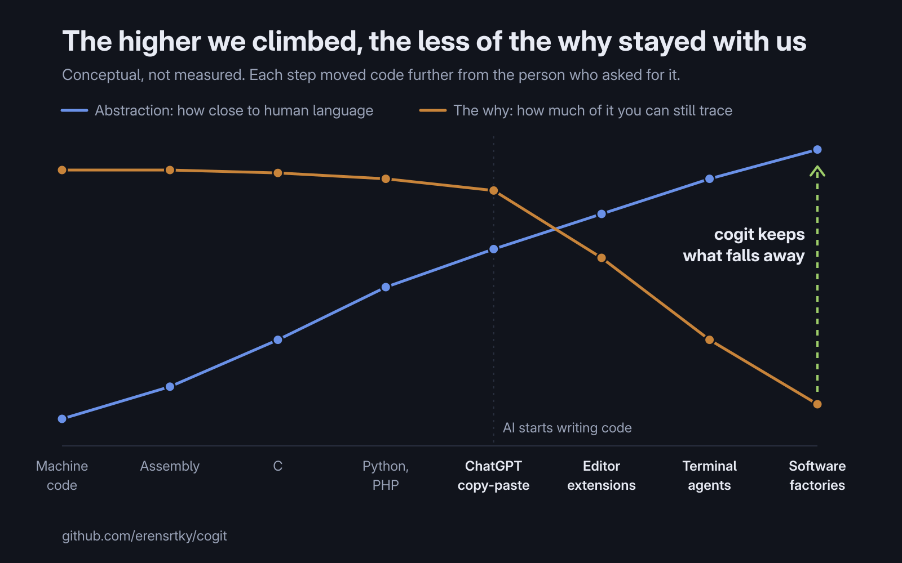
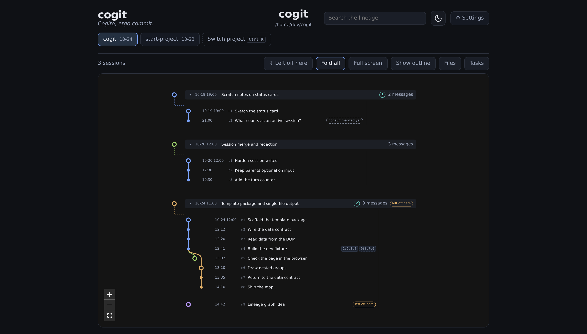
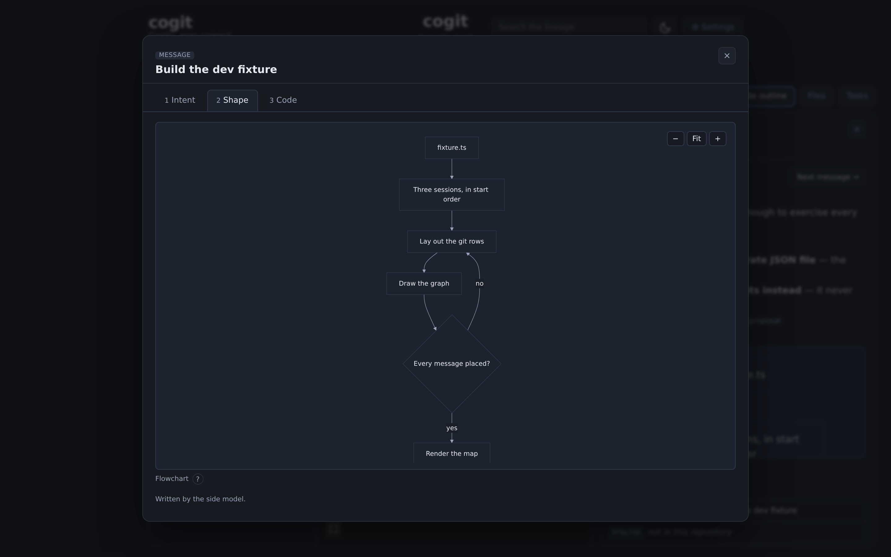
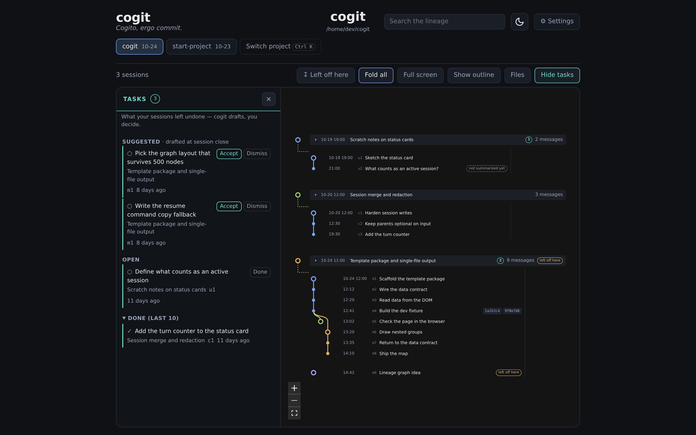
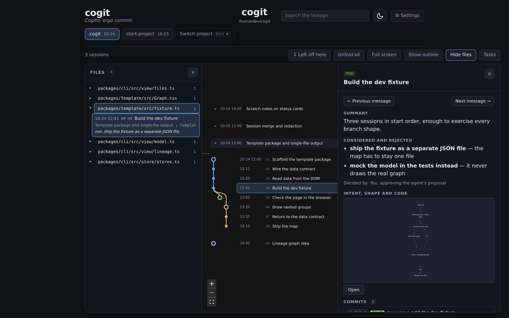

<p align="center"></p>

# cogit

**Git for the intent behind agent-written code.**

<p align="center"><br><i>Cogito, ergo commit.</i></p>

cogit records every message you send to an AI coding agent as a *thought commit*: what you
asked, what came of it, and the message it answered. Your code commits point back to the
thought behind them, so `cogit why` takes any line of code back to the reason it exists. It works
with Claude Code today.

Agent memory helps your agent remember. cogit helps you understand.

It runs as a Claude Code plugin and works through Claude Code hooks, so the record is written
while you work, not reconstructed from the diff afterwards.

**[Click through a saved map](https://erensrtky.github.io/cogit/demo/)**: no install, no server.
It's the page `cogit open` writes, built from sample data and read-only.

## Why

I started by copying code out of ChatGPT, then moved to browser tools, editor extensions and now
terminal agents. Each step moved the code further from me, and I kept feeling something was
slipping away. When you write code yourself, it sinks in bit by bit: you know why that table
exists and why you wrote that class. When an agent writes it, that feeling goes away.

The information isn't really gone. It sits in your messages, the agent's replies and your commits,
just in separate places. cogit ties them together, so you can always walk back and see why
something was done. It helps most when you juggle projects: I run 5-10 agents at once across 2-3
of them, and a few minutes later I can lose track of what I did where.



It's bigger than one person's memory: a reviewer sees what changed, not why.
[More, with research and sources](docs/guide/why.md).

cogit isn't:

- **Agent memory** (OpenViking, Mem0): that helps your agent recall what you talked about.
- **A token saver** (RTK, Headroom): that sends the model less.
- **A code map** (graphify): that shows how a codebase fits together.
- **An orchestrator** (Herdr, Conductor): that runs many agents at once.
- **A planning framework** (BMAD, Spec Kit): that decides what to build next.
- **An AI review bot** (CodeRabbit, Greptile): that comments on whether a diff looks right.

It answers the one question they leave open: why is this code the way it is? I use several of
them alongside it.

## See it



*Your sessions as a git graph — one row per message, the decision behind it, and where you left
off.*



*A message that landed commits opens as Intent, Shape and Code: why it happened, a picture of
what the change does, and the diff.*



*Tasks — work that came up in a session and didn't get finished, caught when the session closes.
You accept, dismiss or close each one.*



*A changed file opens its history: every message that touched it, and the reason behind each —
including the option that was rejected.*

## What it does

- **Every message becomes a thought commit**: the question, the outcome, the decisions with
  their reasons and the options that were rejected, and which earlier message it continues.
- **A map of your sessions**: a git graph of your conversations with branches, decisions, a
  "Your turn" inbox, and Resume and Fork buttons that copy the command to reopen a chat or
  continue it as a new one.
- **Commits point back to their reason**: a `Thought:` trailer on each commit;
  `cogit show <sha>`, `cogit blame` and `cogit why` follow it back.
- **Intent, Shape, Code**: a message that landed commits shows why it happened, a small
  picture of what the change does (a diagram, a before/after or interface table, an example
  or plain steps), and the diff, in one place.
- **Tasks**: when a session ends, a small model catches the work that came up and didn't get
  finished as a few user-level items; you accept, dismiss or close them (`cogit captures`, and
  on the map). Off by default: `cogit config set captures true`.
- **Pull request descriptions with the decisions**: `cogit pr` writes the goal, the
  decisions and the rejected options, never the raw chat. `cogit pr --install-action` adds a
  GitHub Action that posts them on every pull request.
- **Teams share the record through git**: after a pull, your teammates' sessions are on the
  map too, with who ran them and what changed most.
- **The agent's own reasons, or the cheapest record**: a small model records in the
  background and never interrupts the agent. By default, when a session ends, the model it ran
  on reopens the whole conversation and corrects the record with what only it saw, for about
  one more message. Economical leaves it all to the small model: under 2 cents per 20 messages
  in our measurement.
- **No server, no account**: it runs on your machine. Nothing leaves it unless you say so: `cogit
  init` asks whether to share the record (titles, decisions and reasons) with your team. If you
  do, `git push` sends it to your own repository, outside your branches, so it never shows up in
  a pull request or `git status`. Your chats stay local, `cogit prune` deletes old sessions, and
  key and token patterns are redacted.
- **The agent gets the context too**: a new session starts where the last one left off, and
  the agent can look up what was decided and rejected with `cogit why`. It works alongside
  memory tools; it doesn't replace them.

## Install

You need Node 22.13+, Claude Code 2.1.275+ and a git repository.

```bash
npm install -g @cogit/cli
```

Then, in Claude Code:

```text
/plugin install cogit --marketplace erensrtky/cogit
```

To get plugin updates on their own, turn on auto-update once: `/plugin` → Marketplaces →
cogit → Enable auto-update. Claude Code leaves it off for marketplaces outside its own.

If the map stays empty, run `cogit doctor`.

## Quick start

```bash
cd your-project
cogit init        # a few questions: git, transcript retention, team setup, language
```

Work with Claude Code as usual; recording needs nothing from you. Then open the map:

```bash
cogit open .
```

## Guide

- [Getting started](docs/guide/getting-started.md): what `init` asks, your first session,
  setting up a team
- [The map](docs/guide/map.md): sessions, branches, the inbox, files, search,
  resuming and forking a session
- [Reading the lineage](docs/guide/reading-the-lineage.md): `log`, `show`, `blame`, `why`,
  `search`
- [Pull requests](docs/guide/pull-requests.md): `cogit pr`
- [Teams and git](docs/guide/teams-and-git.md): what is shared, the trailer, the hooks
- [Recording and cost](docs/guide/recording-and-cost.md): who writes the record, what it
  costs
- [Privacy](docs/guide/privacy.md): what is recorded and what never leaves your machine
- [Settings](docs/guide/settings.md): every setting, explained
- [Troubleshooting](docs/guide/troubleshooting.md)
- [FAQ](docs/guide/faq.md): questions people asked after the launch
- [Why cogit](docs/guide/why.md): AI made code faster and review slower

The record format is in [docs/format.md](docs/format.md).

## Licence

MIT — see [LICENSE](LICENSE).
