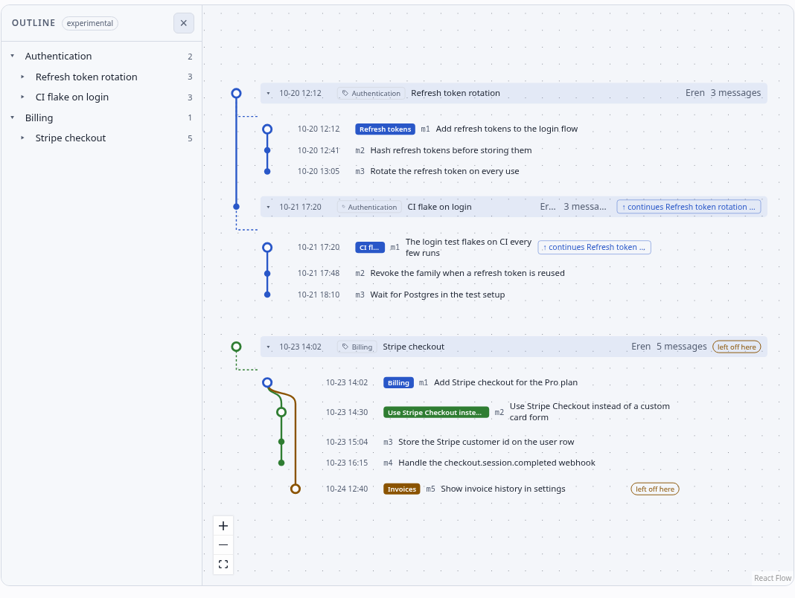

<p align="center"></p>

# cogit

**Cogito, ergo commit.**

Git remembers what changed. cogit remembers why.

<p align="center"><br><sub>After Frans Hals, <i>Portrait of René Descartes</i> (c. 1649).</sub></p>



cogit records every message you send to an AI coding agent as a *thought commit*, with what
came of it and the message it answered. Code commits point back to the thought through a
`Thought:` trailer, so `git log` and `cogit log` tell two halves of one story. Your agent reads
the lineage with `cogit log`, `show`, `blame` and `search`; you read it as a map of sessions,
branches and decisions.

## Why

AI made writing code faster and moved the bottleneck to review. In a Harvard job-market
working paper (Chen and Stratton, 4 August 2026; not peer-reviewed) covering 718 firms and
725,938 workers, AI coding agents wrote 30% more lines of code, made 20% more commits and
opened 23% more pull requests, while resolved Jira issues and epics showed no statistically
significant gain — the paper rules out an increase larger than 12% of the baseline mean. The
review absorbed the difference: average review time rose 49%, comments per pull request 35%,
the share of pull requests with changes requested nearly doubled (0.13 to 0.25), and the share
of workers doing reviews rose 14%. Pull requests did not get larger, so size does not explain
it.

A reviewer reading a diff sees what changed, not why: the goal, the decisions, and the options
that were tried and rejected. That intent stays in the conversation with the coding agent,
where the reviewer cannot see it. cogit keeps it in the record and hands it over: the
`Thought:` trailer links each code commit to the message behind it, `cogit show <sha>` opens
that thought, and `cogit pr` turns a branch into a review-ready description. It does not
promise a faster review — nothing has measured that yet; it gives the reviewer the intent they
would otherwise have to ask for in comments.

Sources: [Chen & Stratton, *Artificial Intelligence in the Firm: Bottlenecks in Software
Production* (working paper, 4 August 2026)](https://fion.ac/jellyfish.pdf) ·
[InfoQ's report](https://www.infoq.com/news/2026/10/jellyfish-ai-productivity/)

## Install

```bash
npm install -g cogit      # the CLI; Node >= 22.13
npx cogit --help          # or run it without installing
```

The Claude Code plugin adds the skill that keeps the record and the hooks that maintain it
(Claude Code 2.1.275 or later):

```text
/plugin install cogit --marketplace sainthardrock/cogit
```

## Quick start

```bash
cd your-project
cogit init        # asks about git, transcript retention, team setup and summary language
cogit open        # builds the map and serves it on 127.0.0.1
```

Then work as usual. The skill updates the record every few turns (`updateEveryTurns`, default
5) and at session end; the hooks write `.cogit/HEAD`, rebuild the map and, if `recordCommit`
is `auto`, commit the record. Nothing in the plugin can block a prompt or a commit: every
hook failure is silent and exits 0.

By default (`recorder: mixed`) a small side model records every few turns outside the chat and
the session's own agent only checks in every 15 turns, which cost us about 1–2% of a session's
tokens. With `recorder: agent` the agent writes the record itself, which added about 3–7% to a
session's token cost in our sessions, more in short ones; `recorder: side` never interrupts the
agent at all. In any mode, raise the turn counts to record less often.

If you agree to the team setup, `init` also writes the project's `.claude/settings.json`
(commit it to share): it turns the plugin on for everyone who opens the repository, and adds a
small hook that stops the first message of a session that started without the plugin, once,
with the install command, since such a session records nothing. Send the message again to go
on without recording. Headless runs (`claude -p`) are never stopped.

## Read the lineage

```bash
cogit log                     # like git log: messages and branches, newest first
cogit log --branches          # only the branch summaries
cogit log --file src/auth.ts  # the thoughts that touched this file
cogit show h3f9c2a1b4d6e      # one message: the turn, what came of it, its commits
cogit blame src/auth.ts:42    # which recorded message produced this line
cogit why src/auth.ts         # what earlier thoughts decided about this file, and rejected
cogit search "refresh token"  # titles, summaries, decisions and the stored conversation
```

Each takes `[dir]` (or `-C <dir>`), the list verbs take `-n <count>` and `--json`. A message is
addressed by its hash (`h` plus 12 hex), `<session-id-prefix>:mN`, or — for `show` — a commit
hash with a `Thought:` trailer.

`cogit why <file>` runs the chain backwards: file → the commits that touched it → their
`Thought:` messages → the decisions and rejected alternatives those messages recorded, newest
first, each with its message hash and date. The lookup is exact, but the wording is the agent's
summary from the record, so it is only as good as the record. The Claude Code plugin also uses
it before an edit: when the file has rejected alternatives and the session has not been told
about that file yet, the agent gets a short "earlier, for this file" note (at most five options,
`tryBeforeNotes`). It is information, not a rule — the note never blocks the edit.

## Review a PR with cogit

On the branch, before opening the pull request:

```bash
cogit pr main --copy   # Markdown on stdout, also copied to the clipboard
```

Open the pull request on github.com and paste it into the description (`gh pr create --body
"$(cogit pr)"` works too if you use `gh`). It prints the goal, the sessions the work came
from, each thought with its decisions and rejected options, and its commits and files — for
example:

```markdown
## Goal
- Add refresh-token rotation — Refresh tokens (9c32ab18)

## Sessions
Open a whole session with `cogit log --session <id>` or the map.
- Refresh tokens (9c32ab18) · m12–m29 · 2026-10-24 09:12 → 2026-10-24 11:40

## Thoughts

### `hb7a9882` 9c32ab18:m24 — Rotate refresh tokens on use

- Why: A leaked refresh token should stop working as soon as it is used.
- Decided by: agreed
- considered and rejected: shorten the token lifetime — it logs people out too often

Commits:
- `a1b2c3d` feat(auth): rotate refresh tokens on use
  - `src/auth/tokens.ts`

## Commits without a recorded thought
- `e4f5a6b` chore: bump deps — thought `h9c8b7a6` not recorded yet

## Dig deeper
- `cogit show <message-hash>` opens a thought: its decisions, the options it rejected, and the conversation turn for whoever has it locally.
- `cogit show <sha>` opens the thought behind a commit.
- This branch commits its record, so a reviewer who checks it out gets the same `cogit show` output.
```

`cogit pr` reads only the record's titles, summaries and decisions — never the conversation
text or your raw prompts — so the description is safe on a public pull request. Under the
default commit policy the record travels with the branch and a reviewer can run `cogit show`;
under `gitPolicy: ignore` the description says the hashes resolve only on the author's machine.

## What git sees

- `.cogit/sessions/` and `.cogit/project.json` are committed by default, so the record travels
  with a clone. `cogit config git commit|ignore` switches an existing project; local state
  (conversations, locks, inbox, map, `HEAD`) is always ignored.
- A `pre-commit` hook stages the current session's record with your next code commit. It never
  creates a record-only commit. `recordCommit` decides what happens to messages recorded after
  the last commit: `ask` (default), `auto` or `off`.
- A `prepare-commit-msg` hook adds `Thought: h<id>` to a commit it can attribute — skipped for
  merges and squashes, and when `.cogit/HEAD` is older than `trailerMaxAgeHours`. `build`,
  `log`, `blame` and the Files view read the trailers back with `git log`.

## Privacy

- The raw conversation stays on this machine. `.cogit/conversations/` holds a local copy of the
  transcript so the panel keeps working after Claude Code deletes it; `.cogit/.gitignore` keeps
  it out of git unless `shareConversations` is on.
- The record holds titles, summaries, decisions and work items — never tool output.
- A redaction pass for keys and token patterns runs over everything the map writes or shows.
- Claude Code keeps transcripts for `cleanupPeriodDays` (30 days by default); `init` offers to
  raise it and never changes it silently.

## Settings

`cogit config get [key]` and `cogit config set <key> <value>`, or **Settings** in the map.

| Key | Default | What it does |
|---|---|---|
| `recorder` | `mixed` | Who records: a side model and the agent (`mixed`), the agent only (`agent`), or the side model only (`side`) |
| `language` | `auto` | Summary language: the conversation's, or a fixed one |
| `updateEveryTurns` | `15` | Turns between the main agent's record updates |
| `sideEveryTurns` | `5` | Turns between the side model's background records |
| `sessionEndCatchUp` | `true` | Summarize the last messages when a session ends |
| `sideModel` | `haiku` | The side model: records every few turns outside the chat and at session end |
| `messageSummaries` | `false` | A summary on every message, not just every branch |
| `startupContext` | `true` | Hand the agent the previous session's lineage at session start |
| `tryBeforeNotes` | `true` | Tell the agent, before an edit, what earlier thoughts rejected for that file |
| `gitPolicy` | `commit` | Whether new projects commit the record |
| `shareConversations` | `false` | Commit the raw conversation too |
| `recordCommit` | `ask` | What to do with messages after the last code commit |
| `inboxMaxAgeDays` | `1` | Days a waiting session stays in the "Your turn" inbox; older ones are hidden, not deleted |
| `trailerMaxAgeHours` | `6` | How old `.cogit/HEAD` may be for a `Thought:` trailer |
| `serverPort` | `4747` | Port for the local map server |

## Docs and licence

The record format — `.cogit/` layout, message ids, events, the `Thought:` trailer — is
[docs/format.md](docs/format.md), with generated JSON Schemas in
[docs/schema/](docs/schema/). The design and the full CLI surface are in
[specs/cogit-mvp.md](specs/cogit-mvp.md), kept up to date with the code. MIT —
see [LICENSE](LICENSE).
