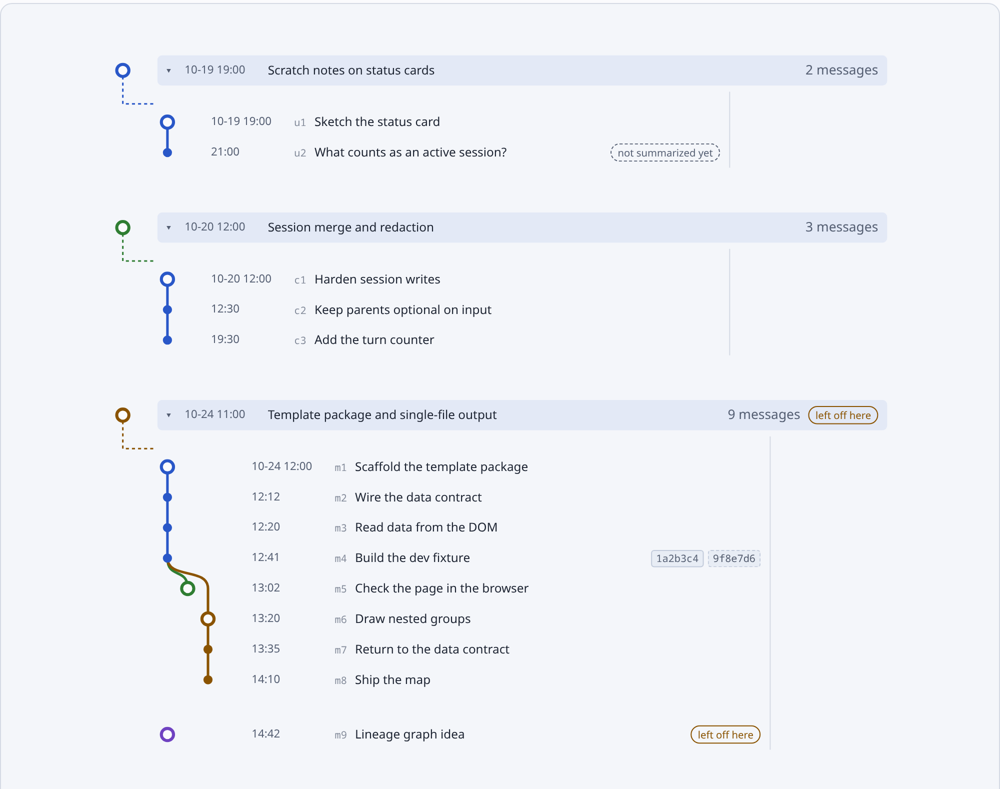

# The map

```bash
cogit open .      # this project's map
cogit open        # the panel: every project on this machine
```

`cogit open` builds the page and serves it on `127.0.0.1` (port 4747, `serverPort`), starting
the server in the background if it is not running. The page refreshes itself whenever the
record changes and keeps your place: the selected message, the unfolded branches, the open
sessions, the scroll and the zoom. Nothing is sent anywhere; the server answers only this
machine. The server stops on its own after 30 minutes without a page open; the next
`cogit open` starts it again.

Times read the same everywhere — `2026-10-30 21:09` in the details panel, the inbox and the
project panel, `10-30` on the project tabs — instead of the browser's locale.

The panel lists every project `cogit init` set up on this machine. A project whose directory
was deleted or moved stays as a card marked "missing"; `cogit config prune` removes those
(`--dry-run` lists them first).

<picture>
  <source media="(prefers-color-scheme: dark)" srcset="../images/map-dark.png">
  
</picture>

## Sessions and branches

The map reads like a git graph of your conversations. Time runs down the page.

- **A session** is one Claude Code chat. Its header shows the title, when it ran, and, when
  someone else's sessions are on the map too, whose it is.
- **A row** is one message you sent, titled in your words and saying what came of it. Rows
  show the date on a day's first row and the time on the rest (`10-24 00:10`), so a long
  session stays readable.
- **A branch** is a chain of messages that answer each other. It gets its own coloured lane;
  its first message is a hollow ring carrying the branch's title. A new topic in the same chat
  starts a new branch, and a message that goes back to an older thread curves out of that
  thread.
- **A continued session** starts with `↑ m37` on its first message, naming the message of an
  earlier session it picks up from; hover it to see that session. A return to an earlier
  message inside a session is listed in the message's details.
- **Long branches fold** to their first and last message and a "⋮ N more — open" row.
  **Unfold all** opens every session and every folded branch; **Fold all** closes them again.
- **"Left off here"** marks the newest message you sent. The map opens there.

A message with commits carries them as small chips with the commit subject, and a
`+1 240 −80 · 14 files` chip saying how much code landed after it.

Clicking a message selects only that message; the details panel shows its branch. A session's
header is highlighted only when the session itself is selected.

The toolbar's Everyone / You / teammate choice fades the other people's sessions while leaving
them in place, so the lines between them stay whole. It appears only when a teammate's sessions
are on the map.

Drag the right edge of an open session's messages to make the rows wider or narrower, so long
titles wrap into fewer lines; double-click the edge to reset. Each session keeps its own width.
Sessions you opened stay open after a reload, and the map still lands where you left off. Both
are stored in the project's local `.cogit/state/map.json`, never in git, so every teammate
keeps their own view.

## Message details

Click a row to open its details in a column beside the map: the map keeps its place and
narrows instead of the panel covering it, though a window narrower than 900 pixels lays the
panel over the map.

- the branch it belongs to, with the branch summary: what was asked, what came of it, what is
  still open
- what was decided, who decided (you, the agent, or both), why, and the options considered
  and rejected
- what the agent did and decided on its own
- the commits and files, each one opening git's own diff
- the conversation turn itself: your message as written and the agent's written replies (tool
  output is left out). This comes from your machine only; see [Privacy](privacy.md).
- previous and next message buttons, and two small buttons that copy a command for the
  whole session: **Resume** (`cd '<project>' && claude --resume <session-id>`) reopens the
  chat where it left off, and **Fork** adds `--fork-session`, so the chat goes on as a new
  session with the same history and the original stays as it was. On the map the fork starts from
  the message it was forked at, like a session that continues another.

## Intent, Shape and Code

A message that landed commits has three layers, in that order:

- **Intent** — the record: the decision, the reason you gave, who decided, and the options
  that were rejected. It is read as recorded, never rewritten here.
- **Shape** — a small representation of what the change *does*, in up to three of these:
  - a **Flow** of the path through the code: each box is one kind of thing (a function, a
    store, a hook, an outside system) with its fixed symbol, and the arrows are the work
    handed between them. An ordered Flow — work handed between parts over time — is drawn
    as a sequence diagram, numbered arrow by arrow;
  - a **Before / After** table for a fix or any change you can see, and an **Interface**
    table for a command, flag, exported function, config key or schema field that changed;
  - an **Example**, one concrete run with real values (every new command gets one);
  - **Steps**, numbered plain-language steps naming the functions and files, each starting
    with its kind's symbol.

  A legend above the tools lists the kinds the Shape uses, symbol and name. The recorder
  writes it, not you, and a tiny change or a pure refactor gets none. The diagrams are drawn
  when the map is opened with `cogit open`; a map opened from the file shows their source.
  `cogit shape --commit <sha> --dry-run` prints the Shape a commit would get without saving
  it. Under the Shape, **Regenerate** asks the side model to write it again — for the answer
  a small model missed, or one you want differently; it replaces a Shape the agent wrote
  too.
- **Code** — the message's commits and their diffs, the same patches the panel opens.

The message details show a short preview and an **Open** button. Open shows the three layers
with 1/2/3 tabs (the number keys work too), starting on Shape. A message with nothing
recorded yet says "being prepared"; with `shapes` off, it says so.


Above the panel's project cards, and folded in a project map's head, the "Your turn" inbox
lists the sessions waiting on you: the agent wrote last, or the record says it needs your
answer. Each row shows the project, the session and the agent's last words, with a link
straight to that message. The × hides a row until the agent writes in that session again.
Sessions older than a day (`inboxMaxAgeDays`) leave the inbox; the map still has them.

## Files

The Files view lists every file a recorded message touched, most recently first, with a
count. Opening a file lists the messages that changed it; opening one of those jumps to it on
the map. In the terminal: `cogit log --file <path>` and `cogit why <path>`.

## Search

The search box in the top bar (Ctrl+F or Cmd+F) finds text in message titles, decisions,
branch summaries, session titles and the stored conversation, ignoring case and accents. Enter
and Shift+Enter step through the hits, Esc clears. A pasted message hash jumps straight to that
message. Sessions the search opened close again when the search is cleared or stops matching
them, unless you clicked into one. In the terminal: `cogit search "<text>"`.

## Switching projects

Under the project's name, a strip of the most recently active projects and
**Switch project** (Ctrl+K, Cmd+K on macOS) search every project on this machine. Each shows
where it left off. "← All projects" goes to the panel.

## Theme

The icon next to Settings switches the theme: a screen follows your system's light or dark
mode, a sun is light, a moon is dark. Hover it to see which is on. The choice is remembered in this browser.

## Settings

**Settings** in the top bar changes the global settings. A "?" next to each one explains it;
there is one Save for all changes. See [Settings](settings.md).

## Without the server

`.cogit/map.html` is a single file and opens without the server too, read-only. It is never
committed: it can contain conversation text.
