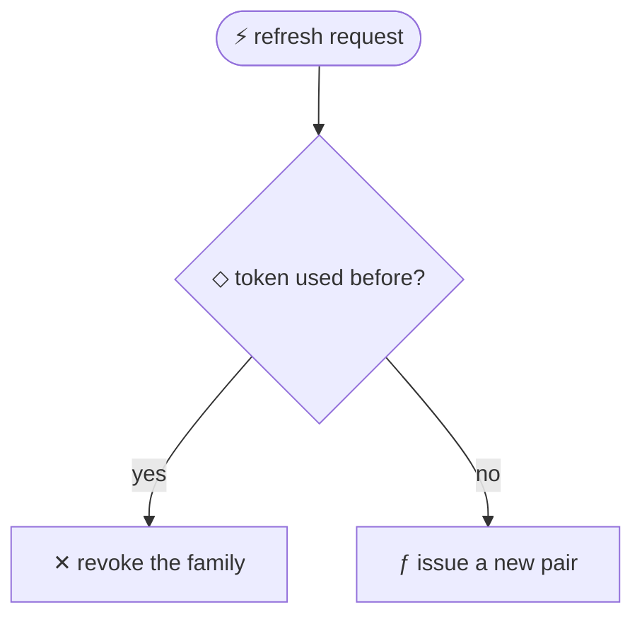

# Pull requests

A reviewer reading a diff sees what changed, not why. `cogit pr` turns a branch into a
description with the goal, the decisions behind the code and the options that were rejected.

On the branch, before opening the pull request:

```bash
cogit pr main --copy   # Markdown on stdout, also copied to the clipboard
```

The map shows the same thing in its **Pull request** view, with a button that copies it. See
[The map](map.md#pull-request).

Without a base it describes everything the branch adds to where it will merge: the branch it
tracks when that is another branch (`main`, or the branch it is stacked on), else the remote's
default branch, else `main`, else `master`. Pushing the branch, merging `main` into it or rebasing
it does not change what it covers. Paste the output into the pull request description on
github.com, or with the GitHub CLI:

```bash
gh pr create --body "$(cogit pr)"
```

The pull request is already open and more commits came in? Rewrite its description, or add the
new one as a comment and leave the description as it is:

```bash
cogit pr | gh pr edit --body-file -      # replaces the description
cogit pr | gh pr comment --body-file -   # adds a comment instead
```

## On every pull request, without running anything

```bash
cogit pr --install-action
```

writes `.github/workflows/cogit.yml`. Commit and push it, and each pull request from this
repository gets the decisions behind its branch as one comment, updated on every push. The
description stays yours. A pull request from a fork gets no comment, since its record stays in
the fork, and neither does a branch with no recorded thought. It needs a project that shares its
record, because the Action reads it from the remote. Delete the file to stop it.

## What it prints

The goal, the sessions the work came from, each message with its decisions and rejected
options, its Shape, and its commits and files. GitHub draws the Shape's diagrams itself. When the message behind a commit is only "commit it",
**Led here** lists the earlier messages of the same thread that decided something, back to
the previous commit. For example:

````markdown
## Goal
- Add refresh-token rotation — Refresh tokens (9c32ab18)

## Sessions
Open a whole session with `cogit log --session <id>` or the map.
- Refresh tokens (9c32ab18) · m12–m29 · 2026-10-24 09:12 → 2026-10-24 11:40 UTC

## Thoughts

### `hb7a9882` 9c32ab18:m24 — Rotate refresh tokens on use

- Why: A leaked refresh token should stop working as soon as it is used.
- Decided by: agreed
- considered and rejected: shorten the token lifetime — it logs people out too often

Led here:
- m21 Keep the old token valid for 30 seconds — two tabs refresh at the same time
  - considered and rejected: a lock around refresh — it adds a round trip to every request

Shape:



Commits:
- `a1b2c3d` feat(auth): rotate refresh tokens on use
  - `src/auth/tokens.ts`

## Commits without a recorded thought
- `e4f5a6b` chore: bump deps — thought `h9c8b7a6` not recorded yet

## Dig deeper
- `cogit show <message-hash>` opens a thought: its decisions, the options it rejected, and the conversation turn for whoever has it locally.
- `cogit show <sha>` opens the thought behind a commit.
- This project shares its record, so a reviewer with cogit in their clone gets the same `cogit show` output once the author has pushed.
````

## Safe on a public pull request

`cogit pr` reads only the record's titles, summaries and decisions, never the conversation
text or your prompts as written.

## For the reviewer

In a project that shares its record, a reviewer with cogit installed can run `cogit show <hash>`
or open the map on the same messages once the author has pushed. A pull request from a fork is
the exception: the record went to the fork, so its hashes resolve only there. In a project that
keeps its record private, the description says the hashes resolve only on the author's machine.

cogit does not promise a faster review; nothing has measured that yet. It hands the reviewer
the intent they would otherwise have to ask for in comments.
